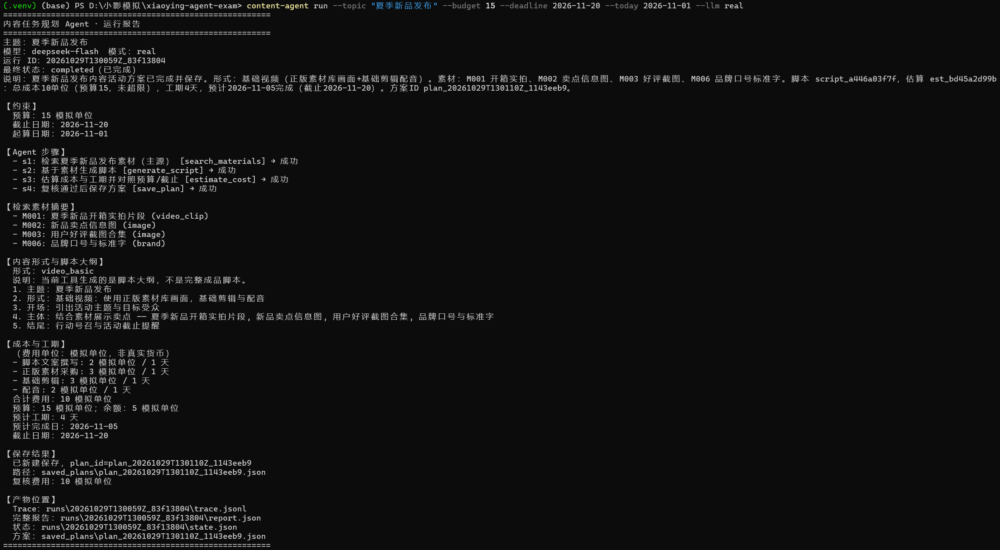
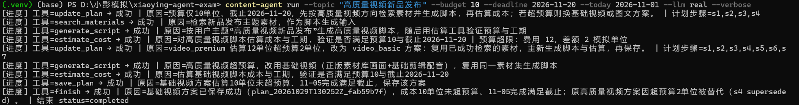
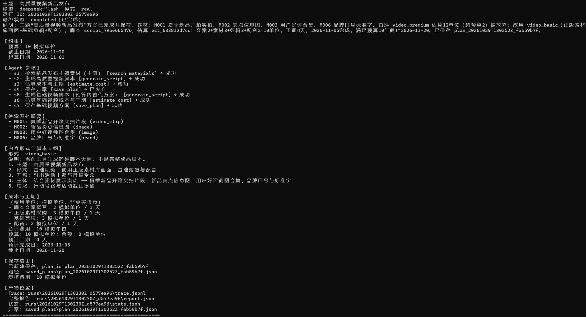

# 内容任务规划 Agent

小影科技 2027 届 AI Agent 校招笔试第 2 题实现。

根据活动主题、预算与截止时间，由真实 LLM（默认 DeepSeek）通过 Tool Calling 动态规划并执行：素材检索 → 脚本生成 → 成本估算 → 方案保存。预算、工期、依赖、幂等与步数上限由确定性代码强制执行。

## 系统架构与技术选型

- **语言 / 入口**：Python 3.10+，CLI（`content-agent`）
- **模型**：OpenAI 兼容接口；默认 DeepSeek `deepseek-flash`，非思考模式
- **架构**：单 Agent + 四个业务工具 + `update_plan` / `finish`；原生循环，不引入 LangGraph
- **硬约束**：`guards.py` / `tools.py`（费用只读 `data/costs.json`）
- **状态与 Trace**：`runs/<run_id>/state.json`、`trace.jsonl`、`report.json`

```
CLI → Agent 循环 → LLM(tool_calls) → ToolExecutor → guards/tools → 观察回传 LLM
```

## 运行效果展示

以下为真实 DeepSeek（`--llm real`）CLI 运行截图。点击图片可查看原图。

### 1. T01 正常任务规划

预算充足时，Agent 依次完成素材检索、脚本大纲生成、成本估算与方案保存，一次跑通。

<a href="docs/images/01-normal-run.png">
  
</a>

### 2. T04 预算超限后自主调整计划

偏好高质量视频时，估算出现费用 12、差额 2（模拟单位）超出预算；模型根据观察调用 `update_plan`，保留已成功检索，改走基础视频路径（动态重规划，非固定分支）。

<a href="docs/images/02-budget-replanning.png">
  
</a>

### 3. T04 重规划后成功保存方案

最终方案形式为 `video_basic`，合计费用 10 模拟单位、工期 4 天、预计完成 2026-11-05；原超限保存步骤已废弃，新路径保存成功并给出 `plan_id`。

<a href="docs/images/03-replanning-result.png">
  
</a>

## 环境安装

```powershell
python -m venv .venv
.\.venv\Scripts\activate
pip install -r requirements.txt
copy .env.example .env
```

编辑 `.env`（不要提交真实密钥）：

```text
LLM_API_KEY=你的密钥
LLM_BASE_URL=https://api.deepseek.com
LLM_MODEL=deepseek-flash
LLM_THINKING=disabled
MAX_STEPS=12
MAX_ATTEMPTS_PER_STEP=3
MAX_CUMULATIVE_STEPS=36
```

## 最简单的运行命令

```powershell
content-agent run --topic "夏季新品发布" --budget 15 --deadline 2026-11-20 --today 2026-11-01
```

默认输出为**中文可读报告**。需要完整 JSON（测试/归档）时加 `--output json`；需要过程日志时加 `--verbose`（进度写在 stderr，不污染 JSON stdout）。

```powershell
content-agent run --topic "夏季新品发布" --budget 15 --deadline 2026-11-20 --today 2026-11-01 --output json
content-agent run --topic "夏季新品发布" --budget 15 --deadline 2026-11-20 --today 2026-11-01 --verbose
```

等价：`python -m content_agent run ...`

缺少 `--budget` 或 `--deadline` 时，CLI 直接拒绝，不调用 LLM。

## 场景示例

**正常完成（预算充足）**

```powershell
content-agent run --topic "夏季新品发布" --budget 15 --deadline 2026-11-20 --today 2026-11-01 --llm real
```

证据：`examples/T01_normal/`

**预算超限后重规划**

```powershell
content-agent run --topic "希望做高质量视频的夏季新品发布" --budget 10 --deadline 2026-11-20 --today 2026-11-01 --llm real
```

证据：`examples/T04_budget_overrun/`（先估 12 超限，再改可行方案）

**工具失败恢复**

```powershell
content-agent run --topic "夏季新品发布" --budget 15 --deadline 2026-11-20 --today 2026-11-01 --inject-failure search_materials:1 --llm real
```

证据：`examples/T03_tool_failure/`

**断点续跑**

```powershell
content-agent run --topic "续跑测试夏季新品" --budget 15 --deadline 2026-11-20 --today 2026-11-01 --inject-failure save_plan:always --llm real
content-agent run --resume <run_id> --llm real
```

证据：`examples/T07_resume/`（同一 `run_id` 的 session1/session2）

## 测试命令

```powershell
# 确定性单元测试（不调用真实模型）
python -m pytest -q

# 仅流程 Mock（不能作为真实决策证据）
content-agent run --topic "demo" --budget 15 --deadline 2026-11-20 --today 2026-11-01 --llm mock
```

带 `@pytest.mark.llm` 的场景依赖真实 Key；未配置时相关用例应跳过，不得标为通过。本仓库正式场景证据均为真实 DeepSeek 运行后落盘到 `examples/`。

## Trace 与结果位置

| 路径 | 内容 |
| --- | --- |
| `runs/<run_id>/trace.jsonl` | 逐步模型动作与工具观察 |
| `runs/<run_id>/state.json` | 完整状态（含失败 attempts） |
| `runs/<run_id>/report.json` | 最终报告 |
| `saved_plans/` | 已保存方案（指纹幂等） |
| `examples/T0x_*/` | 正式验收证据（含 meta.json） |

评审入口：[`docs/03-evaluation.md`](docs/03-evaluation.md) 与 [`docs/acceptance-matrix.md`](docs/acceptance-matrix.md)

## Mock 与真实 LLM 的区别

| 模式 | 用途 | 能否证明动态决策 |
| --- | --- | --- |
| `--llm real` | 真实 DeepSeek Tool Calling | 能；Trace 中 `llm_mode=real` |
| `--llm mock` | `CompletePathMockLLM` 确定性完整成功路径（亦可脚本化测上限） | **不能**；`llm_mode=mock`，仅流程 |

## 模拟数据边界

- `data/materials.json`：合成素材，分 `primary` / `backup`
- `data/costs.json`：三种格式费用为整数模拟单位——`video_premium=12`、`video_basic=10`、`graphic=8`；工期按资源天数串行累加
- 脚本正文为模板拼接（本地工具 Mock）；费用数字**只由代码计算**，模型不可改写
- 「全局不可行」证明仅针对当前费用表中的全部 format，不是真实世界全部内容形式

## 辅助脚本

| 脚本 | 用途 |
| --- | --- |
| `scripts/probe_tool_calling.py` | 真实模型最小 Tool Calling 探测（需配置 Key） |
| `scripts/archive_run.py` | 将某次 `runs/<run_id>` 归档到 `examples/`，不改写 Trace |

## 已知限制

1. 模型路径非确定性：同输入可能选不同 format；测试断言约束与不变量，不要求固定调用顺序
2. 续跑时若原步骤已达 `MAX_ATTEMPTS_PER_STEP`，模型需新建 step_id；跨会话受 `MAX_CUMULATIVE_STEPS` 约束
3. 相同方案指纹命中时 `duplicate=true`（见 T04/T06），属预期幂等，不是失败
4. 指纹含规范化 `outline`；勿与审查前旧 `saved_plans/index.json` 混用期望跨版本命中
5. 不提供 Web UI / 多 Agent / 生产级调度

## 文档索引

- [`docs/01-requirements.md`](docs/01-requirements.md) 需求与验收标准
- [`docs/02-solution.md`](docs/02-solution.md) 方案与技术取舍
- [`docs/03-evaluation.md`](docs/03-evaluation.md) 测试评估
- [`docs/04-ai-usage.md`](docs/04-ai-usage.md) AI 使用记录
- [`docs/05-retrospective.md`](docs/05-retrospective.md) 复盘
- [`docs/exam-question-2.md`](docs/exam-question-2.md) / [`docs/exam-requirements.md`](docs/exam-requirements.md) 官方原文
- [`AGENTS.md`](AGENTS.md) 项目开发规范
